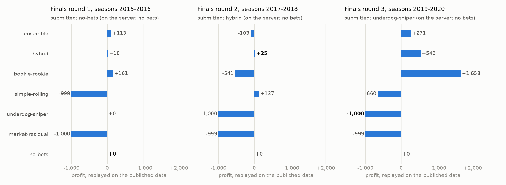
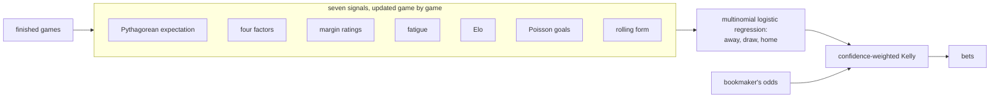

# Betting on ice hockey: QQH 2025

Our team's models from the [Qminers Quant Hackathon 2025](https://github.com/IDA-CTU/QQH2025):
a betting bot for an anonymised ice-hockey league, run day by day against a bookmaker over
seasons it has never seen.

The hackathon code is kept as it was (`originals/`) and rebuilt as a small package (`qqh/`)
that places exactly the same bets, which the tests check stake by stake. Every model is then
replayed on every round of the competition, from the data the organisers published afterwards.

## Results

- **Qualification** (online, about 100 teams): through to the finals, with the hybrid model
  below as our best.
- **Finals** (6 December 2025, 20 teams, three rounds): **8th, without placing a single bet.**
  In round 1 the hybrid's training ran longer than we had planned for on the server's one CPU,
  so a model that bets nothing went in. In round 2 the hybrid's thresholds let no game through.
  In round 3 Pepe's underdog sniper never bet, most likely because it never trained. Most teams
  lost money, so not betting was enough for the middle of the table.

What would the models have done? Each, replayed on the finals' published data:

<picture>
  <source media="(prefers-color-scheme: dark)" srcset="results/replay_dark.png">
  
</picture>

Pooled over the three rounds, no model's profit can be told apart from luck: the most
convincing, the ensemble, made +280 on 174 bets, 1.6 standard deviations from what fair odds
would give. Marek's network is the exception the other way, losing on 1,424 bets at 3.7 standard
deviations. The retuned hybrid's +542 in round 3 comes from four bets. The full tables, what went
wrong in each round and what we would do differently: **[the post-mortem](docs/postmortem.md)**.

## The task

Each day the bot receives the results it hasn't seen yet, the games it can bet on with the
bookmaker's odds (home win, away win, draw) and its bankroll, and answers with stakes. The data
covers 1989 to 2021: 300 to 480 games a season between 14 and 16 teams, with box scores (shots,
saves, penalties, power plays, faceoffs, hits, blocks, goals by period). The bot is one Python
file with a `Model` class, run on one CPU with 5 GB of memory.

| Round | Seasons bet on | Bankroll | Stakes |
|---|---|---:|---|
| Qualification (online) | 2011-12 to 2014-15 | 1,000 | 5 to 100 |
| Bookie Rookie (online) | hidden; a second bookmaker with looser odds | 100 | 1 to 20 |
| Finals, rounds 1, 2 and 3 | 2015-16, 2017-18, 2019-20 | 1,000 each | 1 to 250 |

## The models



| Model | By | What it does | Submitted |
|---|---|---|---|
| `ensemble` | Jakub | the seven signals stacked by a multinomial logistic regression, fractional Kelly | |
| `hybrid` | Jakub, Přemysl | the ensemble's probabilities with Pepe's confidence-weighted Kelly | qualification, finals round 2 |
| `hybrid-retuned` | Jakub, Přemysl | the hybrid retuned later on the finals day | |
| `bookie-rookie` | Jakub, Přemysl | the hybrid tuned for the Bookie Rookie task | Bookie Rookie |
| `simple-rolling` | Jakub | rolling form, Elo and head-to-head in one logistic regression, home bets only | |
| `underdog-sniper` | Přemysl | calibrated probabilities, flat bets on underdogs at odds of 3 or more | finals round 3 |
| `market-residual` | Marek | a network correcting the bookmaker's log-odds, simultaneous Kelly | |
| `no-bets` | | places no bets | finals round 1 |

The signals are in [`qqh/signals/`](qqh/signals), the staking rules in
[`qqh/staking.py`](qqh/staking.py) and the models in [`qqh/models/`](qqh/models), each with the
settings it was last run with.

## Running it

```sh
uv sync                                    # Python 3.12 and the server's package versions
uv run python scripts/fetch_data.py        # the organisers' CSVs, at a pinned commit, into data/
uv run pytest                              # about 3 minutes
uv run python tools/replay.py              # every model on every round, into results/
uv run python tools/summarise.py           # the finals pooled, and the luck test
uv run --group analysis python tools/plot_results.py
uv run python tools/bundle.py hybrid -o dist/hybrid.py    # one file, ready to upload
```

## Repository

| Path | What's there |
|---|---|
| `qqh/` | the package: the evaluation loop, signals, staking, models and rounds |
| `originals/` | the models as the team left them; see [its README](originals/README.md) |
| `tests/` | the evaluation loop against the organisers', the package against `originals/`, the bundles |
| `tools/` | replay, summary, chart and bundler |
| `results/` | the replay's output, and a summary of the team's 21 Optuna studies |
| `docs/` | the post-mortem |

The git history goes back to the hackathon. Much of the November code was written by GitHub
Copilot's coding agent from our prompts, and the history shows which.

## Credits

- **Team:** Jakub Kucera, Marek Vedral, Přemysl Pilař.
- **The 2024 winners'** [qminers-24](https://github.com/AdamBobocky/qminers-24): the ensemble's
  design and the Pythagorean, four-factor, margin-rating, fatigue and Elo signals are adapted
  from their basketball solution.
- **The organisers**, Qminers and CTU FEL: the task, the evaluation loop that
  `qqh/environment.py` reproduces, and the data, which stays in
  [their repository](https://github.com/IDA-CTU/QQH2025).
